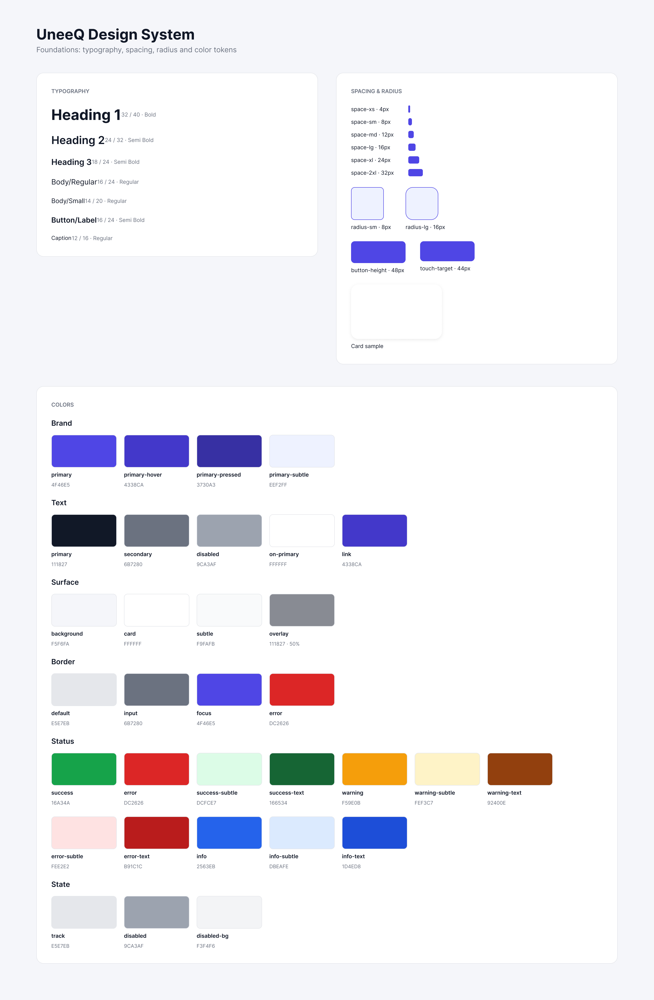
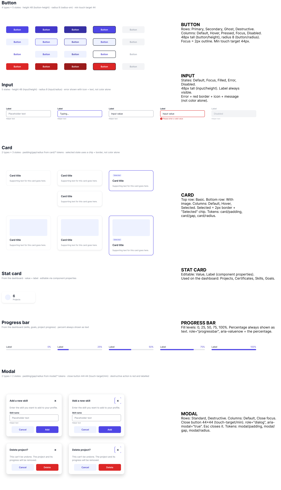
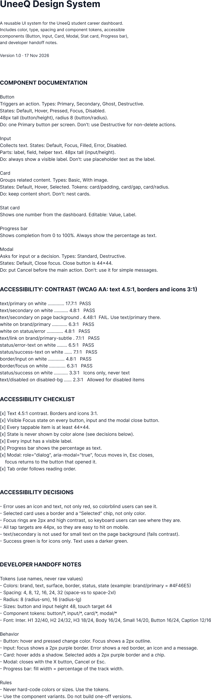

# Design System and Accessibility Kit

A small, reusable UI system for the UneeQ student career dashboard, with accessible components and documentation.

## Links
- Figma file: https://www.figma.com/design/QvMwtmv6dijauM1UP6S5S8/UneeQ-Design-System?node-id=14-2&t=Pvu8DEDpkd0eTZFf-1
- Walkthrough video: [PASTE VIDEO LINK]

## Foundations
Typography, spacing, radius and color tokens.

## Components
Button, Input, Card, Stat card, Progress bar and Modal, with their variants and states.

## Documentation
Component documentation, WCAG contrast checks, an accessibility checklist, accessibility decisions and developer handoff notes.

## Highlights
- Tokens for color, type, spacing, radius and sizes, used by name instead of raw values.
- Six components, each with documented variants and states.
- Contrast checked against WCAG AA: 4.5:1 for text, 3:1 for borders and icons.
- State is never shown by color alone. Errors use an icon and text, and selected cards use a border and a chip.
- Every tappable item is at least 44×44, and every button, input and modal close button has a visible focus state.
