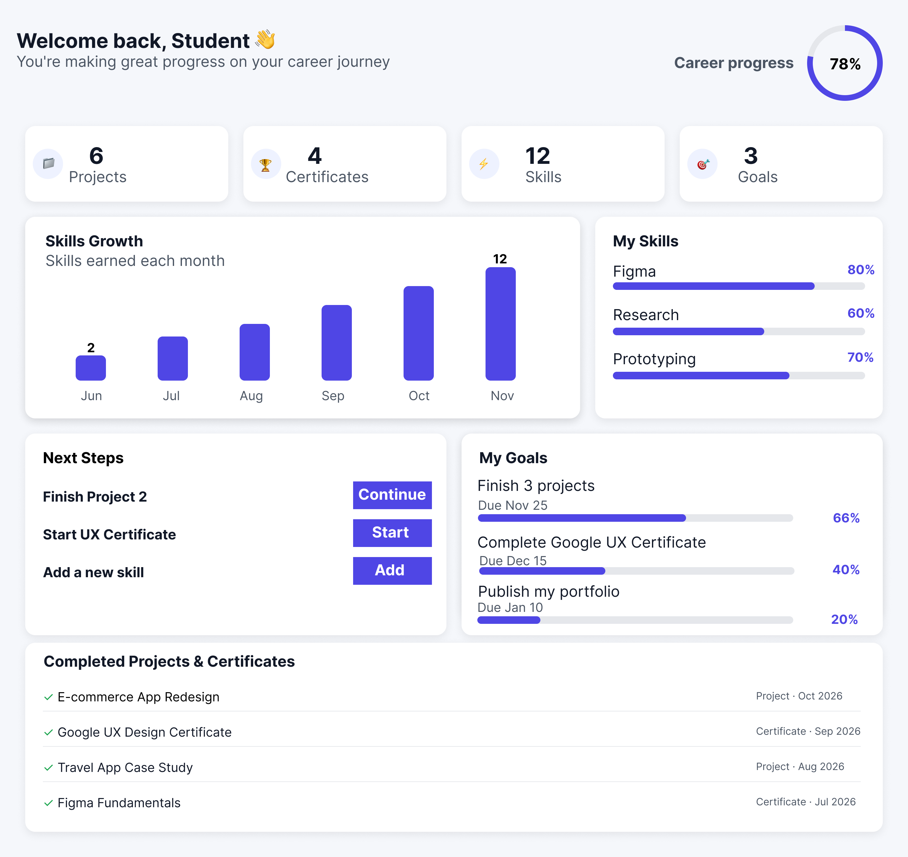
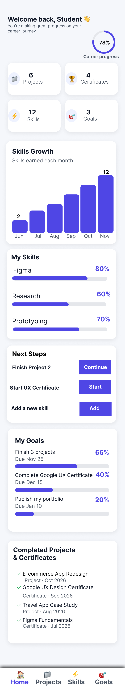
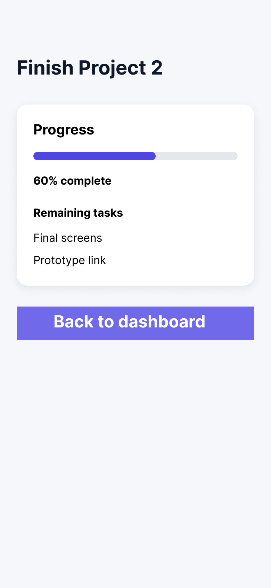

# Student Career Progress Dashboard

A responsive dashboard that shows a student's completed projects, certificates, skills earned and upcoming goals. The focus is on progress clarity and motivation.

## Links
- Figma file: https://www.figma.com/design/hRanpyShdOjQx3TVQoqB4K/Student-Career-Progress-Dashboard?node-id=1-2&t=7YWGvUU4wnnR9Jg4-1
- Walkthrough video: https://drive.google.com/file/d/11FDSjNATfzl-orm847IwScToMrJtEH-I/view?usp=drive_link

## Screens

### Desktop (1440 px)

### Mobile (390 px)

### Project details
Opens from "Continue" under Next Steps, and shows progress and the tasks that are left.

## What the design includes
- A career progress ring and four summary cards: projects, certificates, skills and goals.
- A skills growth chart that shows skills earned each month.
- Skill bars that show how strong each skill is, with the percentage written next to each bar.
- Next steps with one clear button for each action.
- Goals with deadlines and progress.
- A completed list of projects and certificates.
- On mobile, the cards stack into one column and a bottom navigation bar keeps Home, Projects, Skills and Goals one tap away.
